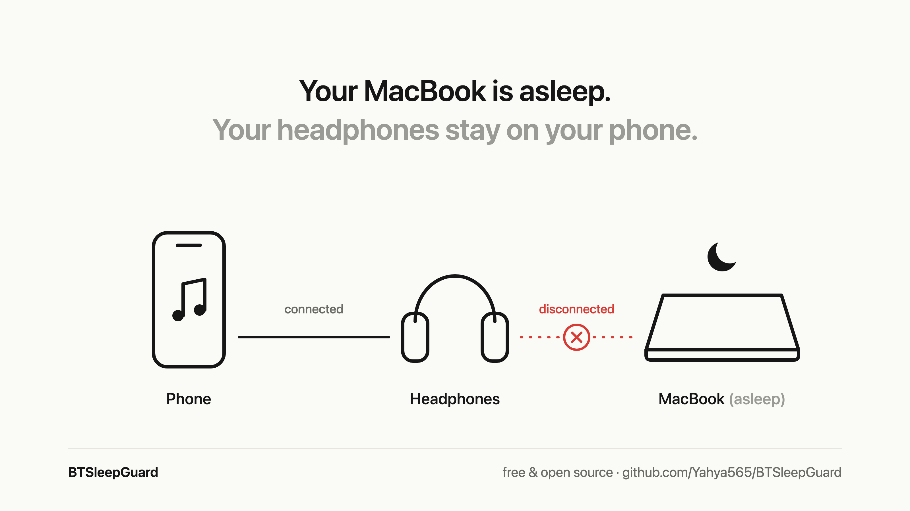

# BTSleepGuard



Stops Bluetooth headphones from connecting to your MacBook while it's asleep.

If you use multipoint headphones (Soundcore, Sony, Bose, etc.), you've probably had this happen: you take your headphones out of the case, and instead of your phone, they connect to the MacBook sitting closed in your bag. BTSleepGuard watches for that and immediately disconnects them, but only while the Mac is asleep. When you open the lid, everything works as normal.

## Install

Paste this into **Terminal** and press Enter:

```bash
curl -fsSL https://raw.githubusercontent.com/Yahya565/BTSleepGuard/main/install.sh | zsh
```

The installer will:
1. **List your paired Bluetooth devices**, with headphones first. Type the number of yours, or just press Enter if it's the default.
2. **Download and start BTSleepGuard.**
3. **Show a macOS prompt asking to let BTSleepGuard use Bluetooth.** Click **Allow**, then press Enter back in Terminal. The installer checks that access was granted, and if it wasn't, it opens the right System Settings page for you.

That's it. It starts automatically at login. Works on macOS 12+ on both Apple silicon and Intel Macs. Nothing else to install.

**To change devices**, run the same command again. **To uninstall:**

```bash
curl -fsSL https://raw.githubusercontent.com/Yahya565/BTSleepGuard/main/install.sh | zsh -s -- --uninstall
```

## How it works

It's a tiny native background program (~190 KB) that macOS wakes only when something relevant happens. It runs no polling loops and no shell scripts, and uses no CPU when idle.

| Event | What it does |
|---|---|
| Mac is about to sleep | Starts the "asleep" window and disconnects your headphones if they're still connected |
| Any Bluetooth device connects | If the Mac is asleep and it's one of your headphones, disconnects it immediately |
| Display turns on (you open the lid) | Ends the "asleep" window |

- **Dark wakes / Power Nap** (the Mac briefly waking with the screen off) count as asleep, so connections during those are caught too.
- **Screen off while you're using the Mac** (idle display sleep) doesn't count, so listening with the screen off still works.
- **It never reconnects your headphones on wake**, so it won't steal them from your phone.
- **It only affects the devices you choose.** Your keyboard, mouse, etc. are left alone.

## Check it's working

```bash
log stream --predicate 'subsystem == "local.btsleepguard"'
```

Close the lid, take your headphones out of the case, then open the lid. You should see:

```
disconnected Soundcore P3i: connected while asleep
```

You may see a few of these in quick succession. That's normal: after a link drops, most headphones retry the last device a few times before giving up. macOS accepts the connection before any app is told about it, and there's no public API to refuse a paired device, so each retry is cut within milliseconds until the headphones stop trying (usually within a few seconds).

## Build from source

If you'd rather compile it yourself (needs the Xcode Command Line Tools: `xcode-select --install`):

```bash
git clone https://github.com/Yahya565/BTSleepGuard.git
cd BTSleepGuard
./install.sh --build
```

You can also skip the list by passing a name or address: `./install.sh "Soundcore P3i"`.

## Why not sleepwatcher + blueutil?

Those are great tools, but neither tells you when a device *connects*. The common workaround is a shell loop that runs `blueutil --disconnect` every few seconds while the Mac sleeps. That loop is frozen during real sleep, can miss short dark wakes, and starts several processes every cycle. BTSleepGuard uses macOS's own Bluetooth connection notification instead, so it reacts the moment the headphones connect and costs nothing in between.

## Notes

- The app isn't notarized (that needs a paid Apple developer account). The install command downloads it directly, so macOS doesn't block it. If you prefer, build it yourself from source.
- With the lid closed and an external display connected (clamshell mode) the Mac isn't asleep, so nothing is disconnected. This is intended.

## License

MIT
